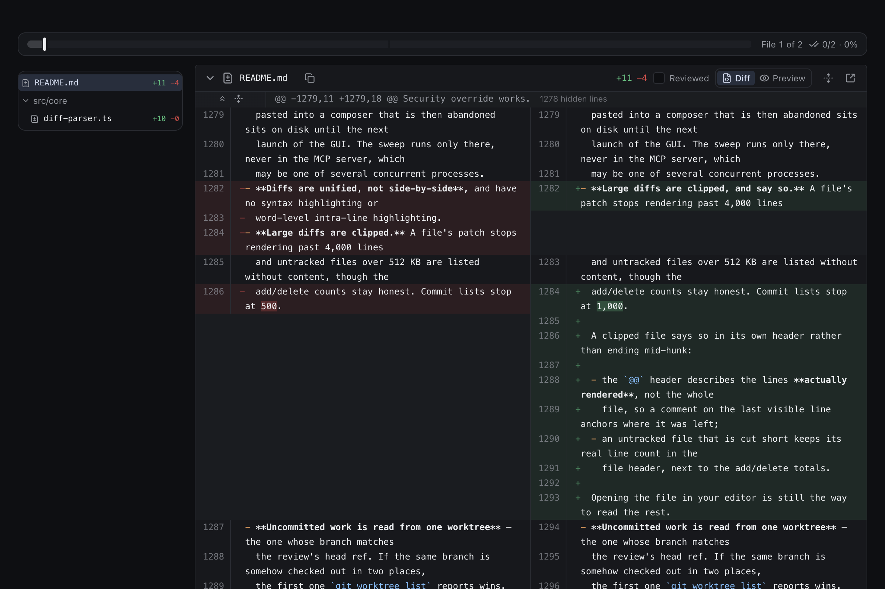
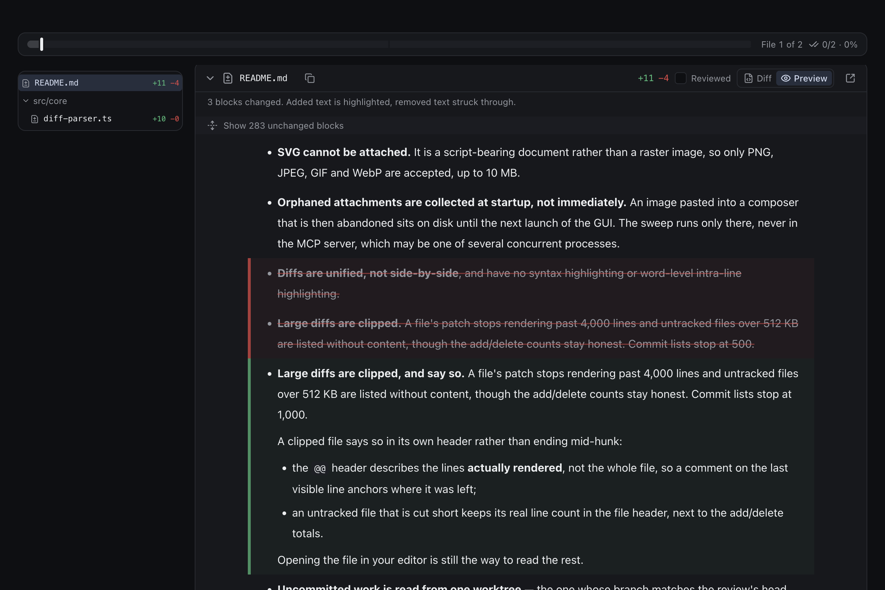
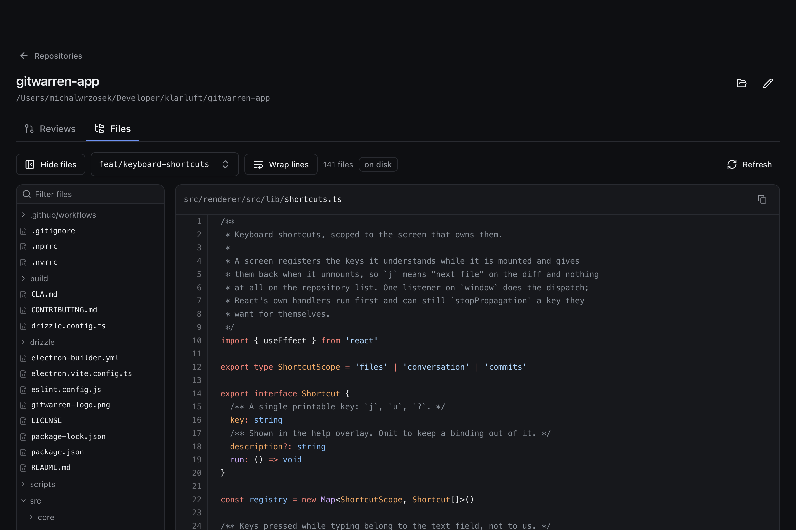
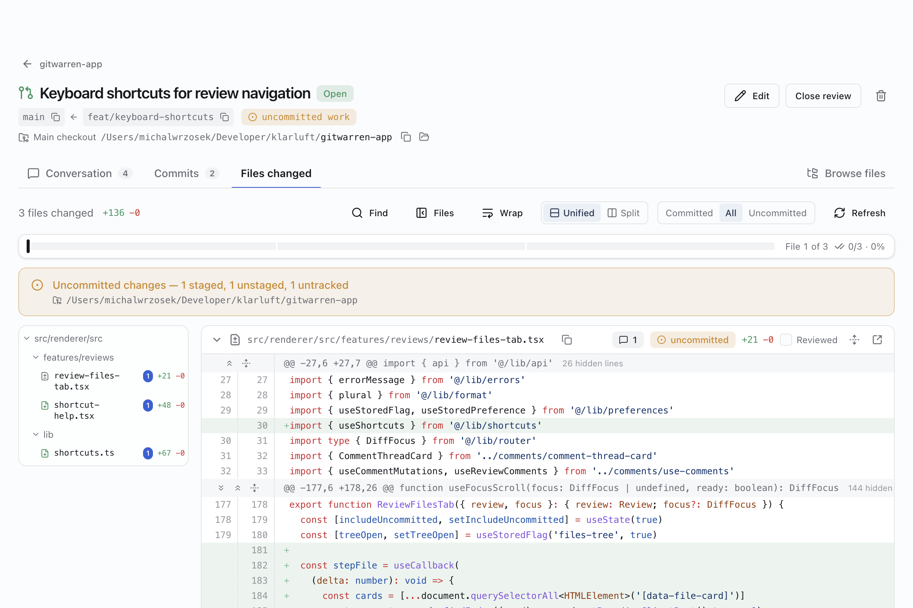

# Reviews

A review is two refs and a title. Everything else on the screen is computed from
git when you look at it.

```
  reviews table                    read live, never stored
  ┌──────────────────┐             ┌───────────────────────────────┐
  │ repository_id    │             │ merge base of the two refs    │
  │ base_ref  "main" │  ──────►    │ commits in base..head         │
  │ head_ref  "feat" │             │ diff from the merge base      │
  │ title            │             │ which worktree holds head     │
  │ description      │             │ that worktree's dirty state   │
  │ status           │             └───────────────────────────────┘
  └──────────────────┘
```

## Why the refs are stored and the commits are not

Pinning the resolved shas at creation time would be the obvious thing to do, and
it would defeat the feature. A review is meant to *follow* its branch: you open
one, keep working, and the review shows the work as it stands. That includes work
that is not committed at all, which no sha could ever refer to.

The cost is that a review can stop resolving — someone deletes the branch. That
is treated as a state to render, not an error: the review row survives, the tab
says which ref went missing, and you can repoint it.

## Merge-base, like a pull request

The *files changed* tab shows `base...head` — what head added since the two
diverged — rather than the literal difference between the endpoints. So commits
that landed on `main` after you branched do not show up as reversals in your
review. The *commits* tab lists the same range, `base..head`.

## A ref against itself

The two endpoints may be the same ref. That is not an empty review: the merge
base of a ref with itself is its own tip, so the diff is exactly what the
worktree holds that has not been committed — the review you want when you just
wrote the code and want a second pair of eyes before it becomes a commit. Such a
review has no commits by definition, is titled *Uncommitted work on `<ref>`* by
default, and is drawn with one endpoint rather than an arrow between two.

## Finding uncommitted work

This is the part that needs care, because **the repository row points at one
directory and the work under review is often in another**. A branch checked out
in a linked worktree has its uncommitted state there, not in the main checkout.

So every read starts with `git worktree list --porcelain`, which enumerates the
main checkout and every linked worktree from *any* of them — it does not matter
which one was added to GitWarren. The worktree whose branch matches the review's
head ref is the one whose `git status` and working-tree diff get read. If no
worktree has that branch checked out, the review quietly falls back to committed
work only and says so.

Given the head's worktree, the diff is `git diff <merge-base>` run **inside it**,
with no second endpoint — which compares the merge base against the working tree,
so committed, staged and unstaged changes all arrive in one patch.

The files-changed tab offers three views of that, and the difference between
them is only which commit the diff is taken against:

| View | Command | What you see |
| --- | --- | --- |
| Committed | `git diff <merge-base> <head>` | the branch as it would arrive if pushed |
| All | `git diff <merge-base>` in the worktree | that, plus everything uncommitted |
| Uncommitted | `git diff <head>` in the worktree | only the edit being made right now |

The third exists for the case where you are making a small change on top of a
long-lived branch and want to see just that change. It is the same view a review
of a ref against itself gives — the merge base of a ref with itself *is* its own
tip — reached without repointing the review's endpoints and back again. It needs
a worktree holding the head; without one it shows nothing rather than silently
widening back out to the whole branch.

Untracked files are handled separately: they are listed with
`git ls-files --others --exclude-standard` (so `.gitignore` still applies) and
rendered as whole-file additions. The tempting alternative — staging them into a
scratch index with `GIT_INDEX_FILE` — would write blobs into the user's object
database just to draw a screen, and this app only ever reads.

The three-way control at the top of the tab picks between them, and `u` steps
through it. It is view state, not part of the review: whether you want to read
the branch as it sits on disk or as it would arrive if pushed is a per-visit
question.

## Where the branch is checked out

The worktree lookup above happens on every read anyway, so its answer is shown
rather than thrown away. The review header has a line under the two refs saying
*Main checkout* or *Worktree*, then the full path, with a copy button and, where
this machine can name the path, **Show in file manager**. Each row of a
repository's review list shows the folder name of its head's worktree, with the
same two buttons. Knowing the branch but not where it lives is the slow part of
getting from a review to a terminal in the right directory. When no worktree has
the branch checked out, nothing is shown there, and the tabs say the review is
committed work only.

## Reading the diff

`git diff` output is parsed once, in `src/core/diff-parser.ts`, into files,
hunks and numbered lines. Two details that a naive line-splitter gets wrong and
this one does not: paths are taken from the `---`/`+++` and `rename from`/`to`
lines rather than the ambiguous `diff --git a/x b/x` line, and a pure rename
carries no hunks at all yet still has to name both paths. Very large files are
clipped for rendering but still report their true add/delete counts.

Code is highlighted with Shiki, in GitHub's own light and dark themes, so a
diff reads the way the same diff does on a pull request. Grammars load the
first time a file in that language is drawn, and the set is curated rather than
complete; see [Known limitations](limitations.md). A changed image is drawn as
the two images, old beside new, rather than as the words "binary file".

## Navigating a large diff

Files changed carries the things a long diff needs, all of them optional and
none of them costing anything until used:

- **A file tree** down the left, folded so a lone directory collapses into its
  parent (`renderer/src` on one row). Clicking a file scrolls to it, and the row
  for whatever is nearest the top of the page stays highlighted as you scroll;
  the list scrolls itself to keep that row in view, so on a branch of two
  hundred files it does not fall behind. The column can be dragged wider for
  deep paths, and once a branch has fifteen or more changed files a filter box
  sits above it. `t` shows and hides it, and the choice is remembered across
  restarts. `]` and `[` step to the next and previous file.
- **Find in the diff**, `⌘F` (`Ctrl+F` outside macOS), with `⌘G` and `⇧⌘G`
  for the next and previous match. The button beside its arrows takes the word to
  [Browse files](#browse-files) to find where it is defined.
- **A file over 600 lines arrives folded**, with its header and counts still
  showing, so one regenerated lock file does not push everything else a long
  scroll away.
- **Unfolding the lines between the hunks**, the way GitHub does. `git diff`
  prints three lines of context, so most of a file is not on screen; the
  expanders in the gutter reveal twenty lines at a time or the whole run, and
  **Expand all lines** in the file header opens every gap at once. Unfolded
  lines are ordinary context rows — a comment can be left on one exactly as on
  any other line.

A `@@` header announces a break in the file, so it is drawn only while there is
still a break to announce. A folded gap carries the header on its own expander
row, the way GitHub puts the unfold controls there; unfold that gap and the
header goes with it, because the code now runs continuously into the hunk and a
divider across continuous code is a false statement about the file. Expand
everything and the file reads top to bottom with no markers in it at all.

The same rule removes the header from the top of a hunk that starts at line 1,
which is every new file and every deleted one: there is nothing above it to be
separated from. What keeps a header is a real break with no expander to mark it
— which happens in the files the diff cannot unfold at all (binary, clipped),
where it is the only thing saying two lines are not adjacent.
`continuesFromAbove` in `shared/diff-gaps.ts` decides this, using the same
off-by-one convention for empty ranges as the gap arithmetic beside it.
- **Copy path** and **open in your editor**, per file.
- **Back to top**, once you are a screen or so down. It is app-wide rather than
  a diff feature, but the diff is where the scrollbar gets small enough to
  matter. Two details: the whole app scrolls inside `<main>` rather than the
  window, so the button acts on that element (`window.scrollTo` would do
  nothing at all here); and the trip is animated only when it is short enough
  to follow — smooth-scrolling the length of a large diff takes seconds and
  reads as the app hanging, so past five thousand pixels it simply jumps.

Every icon-only control carries a real tooltip rather than a `title` attribute
(`components/ui/tooltip.tsx`). The browser decides when to show a `title` —
usually a second or more after the pointer stops — it cannot be styled, and it
never appears for keyboard users at all; a button whose whole meaning is its
label cannot afford any of that. One `TooltipProvider` at the root groups them,
so the first tooltip waits and moving along a row of buttons then shows each
immediately. `title` is still used for *supplementary* text: the full path
behind a truncated one, the meaning of a badge.

The unfolding costs one read of the whole file, taken the first time the
reviewer asks and reused for every later expansion of the same file. It is
deliberately not a line-range API: a range per click would be a git process per
click, and reading the file once is also the only way to know where it *ends*,
which no hunk header can say. The read follows whichever view of the changes is
on screen, because context taken from another version of the file would not line
up with the hunks it sits between. `src/shared/diff-gaps.ts` holds the arithmetic that
decides where the hidden runs are and which line number each unfolded line gets;
it is pure, and unit-tested against the shapes that get this wrong — a diff that
does not start at line 1, and git's off-by-one convention for an empty range.

## Side by side, and long lines

The diff can be read **unified** or **split** — the toggle at the top of Files
changed, or `s`, remembered across restarts. Split puts each run of removed
lines level with the lines that replaced them, and a comment thread sits under
the half it is about. A window narrower than 1024 pixels, which includes every
phone, is always unified, because two columns of code that narrow are not
readable.

In both layouts, a line that was edited rather than rewritten highlights only
the words that changed. This matters most for prose, where a paragraph is one
long line and a single changed word would otherwise colour all of it.



**Wrap** lets a long line break onto the next row instead of scrolling the card
sideways. The `+`/`-` marker hangs in the margin so continuation rows sit under
the code, and the line number stays on the first row. Code starts unwrapped and
prose (`.md`, `.txt`, `.rst` and the like) starts wrapped, because a chapter
that scrolls sideways is unreadable; pressing the button sets both. The same
choice applies in Browse files and the repository's Files tab. Split always
wraps, since each half has no scrollbar of its own, so there the button shows
as on and cannot be pressed. Unwrapped, the line numbers stay pinned at the
left while the code scrolls sideways under them.

## Markdown files

More and more of what gets reviewed is not code — agent instructions, plans,
specs, READMEs, whole books — and Markdown is written to be read rendered. So
every Markdown file in Files changed has a **Diff | Preview** switch. The
preview is not a plain render of the new version, which would hide the change
under review: added blocks are marked green, removed ones are struck through,
and inside an edited paragraph the removed words are struck out and the added
ones highlighted in place, the way tracked changes look in a word processor.
In split layout it shows the old document beside the new one. Unchanged
stretches fold.



You can comment on a paragraph from the preview. It is the same call as
dragging a comment over those lines in the diff, so the thread is anchored by
the same rules, shows on those lines when you switch back to the diff, and an
agent reads it like any other line comment.

A preview also behaves like a document rather than a picture of one.
Repository-relative images are drawn from the repository; links to other files
in it open them in the app, `#heading` and `other.md#heading` land on the
heading, and a link to a folder opens its README. URLs still open in your
browser. Raw HTML is not rendered, but `` and `<a href>` — which most
READMEs draw their pictures with — are read into ordinary Markdown images and
links, so they display the same way and follow the same rules: only files from
the repository are drawn, and anything remote stays a link.

The old version of the file is not read from git separately. It is rebuilt from
the new one by applying the hunks in reverse (`rebuildBase` in
`features/reviews/markdown-diff.ts`), and if the text and the hunks do not line
up the preview refuses rather than guessing.

## Browse files

Reviewing a change often means reading code the change did not touch: the
caller of the edited function, the test that was not updated. **Browse files**
is the fourth tab of a review, and shows any file in the repository as it is at
the review's head — from the worktree when one holds the branch, so uncommitted
changes are included, and from the head commit otherwise. A comment can be left
on any line there, and it lands in the same review as the comments on the diff.
The file being read is part of the address (`#/reviews/4/browse/src%2Fapp.ts`),
so it survives a reload and can be pasted to someone. A Markdown file has a
**Source | Preview** switch here, and the last choice is remembered.

The file list has a filter that leads with the file name, and **Search in
files** (`⇧⌘F`, from any tab of the review) runs `git grep` over the same
version of the repository: match case, regular expressions, and VS Code-style
include and exclude globs. Opening a result goes to that line with the match
marked. The query is in the address too; the options are remembered as your
preferences rather than carried in a link.

## The repository's Files tab

The same file tree and file view, on the repository screen, without having to
open a review first. It reads the checkout on disk by default, uncommitted
files included, and a ref picker reads any branch or tag instead. Markdown
files get the same Source | Preview switch. There is no comment gutter, because
a comment belongs to a review. The file and the ref are part of the address
(`#/repositories/3/files/<path>?ref=<ref>`).



## Refreshing

The commit and diff reads do not refresh on their own (see
[Known limitations](limitations.md)), so Files changed has a **Refresh** button,
and `r`. It re-reads the diff and then the text of every file behind it — the
text the expanders and the Markdown preview work from, and the images — so a
preview never compares a new diff against an old copy of the file. What is on
screen stays until the new read lands, so nothing flashes. The repository's
Files tab has the same button and re-reads the open file as well as the list.

## Marking a file reviewed

Each file header carries a **Reviewed** checkbox, and `v` ticks off whichever
file you are on. A ticked file folds away and the file tree marks it and dims
it, so a long diff shrinks to what is still unread as you work through it.

Progress is shown as a strip pinned above the diff, with one equal slot per
file whatever its size: green for reviewed, amber for changed since reviewed,
and a marker for where you are. Counting files rather than lines is the point —
a branch with four source changes and a regenerated 20,000-line lock file is
one file of five through when you are halfway down the lock file, not 99%. Click
a slot to go to that file, or hover it to see which file it is. On a touch
screen, tap a slot, or press and slide along the strip to scrub through the
files and lift to go to the one named under your finger.

The mark has to stop being true when the file changes, or the list would claim
someone had read code that did not exist when they looked at it. So what is
stored is not a flag but a digest of the diff that was on screen at the time
(`shared/diff-digest.ts`, a cyrb53 fingerprint of the path, the change status
and every line of every hunk). A mark counts only while the file still hashes to
the same value; when it does not, the tick clears itself and the file is
labelled **Changed since reviewed** — which is more useful than silently
unticking it, because it points at the one file that moved after being read.

Two consequences fall out of that rather than needing code of their own. Each of
the three views of the changes is a different diff, so a file read in one view
is not necessarily ticked in another. And reverting a change restores the mark, because the file
hashes the same way it did before.

The comparison runs in the renderer, against the diff being rendered, and the
main process only stores digests: the views of the changes mean one review has
several diffs at once, and a mark resolved against the one you are not
looking at would be answering a question nobody asked. The rows live in
`reviewed_files`, keyed by review and path, and go with the review when it is
deleted. There is no MCP tool for them — an agent claiming a human has read a
file would make the only honest signal on the screen worthless.

## Opening a file in an editor

`system.editors()` probes for VS Code, Cursor, Windsurf, Zed, Sublime Text and
the JetBrains launcher, once per run: the application bundle in the usual
locations, and the command on `PATH`. Whatever is found is offered in a picker
next to the diff, and the choice is kept in `localStorage` — a preference of the
person, not a fact about the review, and this app has no settings screen to put
it on.

Opening prefers the URL scheme the application registered for itself
(`vscode://file/…:12`), which carries the line number and works whether or not
the user ever installed the shell command; the CLI is the fallback, and the
platform's default handler for the file is the fallback to that.

Set `GITWARREN_EDITOR` to override, either with an id from the list above or
with a command template:

```sh
GITWARREN_EDITOR='emacsclient +{line} {file}'
```

The file is resolved inside the worktree that holds the head branch, not
necessarily the directory the repository was added from — the same rule the rest
of the app follows. A file that exists only in a commit has nothing to open, and
says so.

## Keyboard

`?` lists the keys that work on the screen you are on, and `⌘K` (or `/`) opens
the command palette, which can run everything below and a few things that have
no key, such as closing a review. Both are generated from one registry, so the
list cannot drift from the keys that actually fire. No shortcut fires while you
are typing in a field or while a dialog is open. `⌘` is `Ctrl` outside macOS.

| Where | Keys |
| --- | --- |
| Anywhere | `g h` repositories, `g a` agent access, `g s` hosts, `g t` scroll to top, `⌘[` / `⌘]` back and forward, `j` / `k` next and previous item |
| Home | `n` add a repository, `r` refresh |
| A repository | `n` new review, `r` refresh, `1`–`3` filter the reviews by status, `e` edit the repository, `o` show it in the file manager |
| A review | `1`–`4` the four tabs, `e` edit the review, `g r` back to its repository, `⇧⌘F` search in files |
| Files changed | `]` / `[` next and previous file, `v` mark reviewed, `t` file list, `u` which changes, `s` unified or split, `⌘F` find, `r` refresh |
| Hosts | `n` add a host, `r` refresh |

## Light and dark

GitWarren follows the operating system's light or dark setting by default. The
switch in the top-right corner of the home screen — **Match system**, **Light**,
**Dark** — overrides it, and the same three choices are in the command palette
from any screen. The choice is kept per device in the browser's storage rather
than in the database, so a phone reading a review from another machine keeps
its own.


